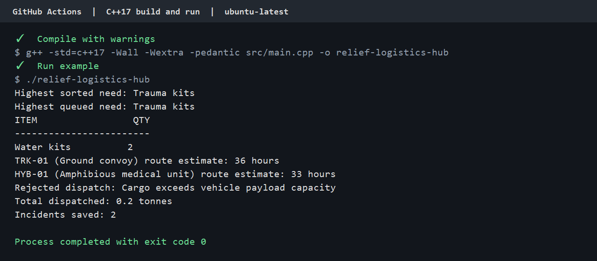

# Emergency Relief Logistics Hub

A beginner-oriented C++17 console project for tracking emergency supplies and evaluating relief-vehicle routes after an earthquake. It demonstrates the CIC-211 assignment mechanisms in a small example that can be read from `main()` outward.

## Build and run

With g++ on Linux or macOS:

```sh
g++ -std=c++17 -Wall -Wextra -pedantic src/main.cpp -o relief-logistics-hub
./relief-logistics-hub
```

With MinGW g++ on Windows:

```powershell
g++ -std=c++17 -Wall -Wextra -pedantic src/main.cpp -o relief-logistics-hub.exe
.\relief-logistics-hub.exe
```

The program writes binary incident records to `incident_log.bin` in its current working directory. That generated log is ignored by Git.

## Verified run output

The image below shows the successful GitHub Actions run. It compiled the project as C++17 with warnings enabled, ran the example, and printed the route estimates, the rejected overweight dispatch, and the saved incident count.



## What to look at

- `ReliefOps::Inventory::ReliefCargo` owns a dynamic array and implements a deep copy, destructor, and stream operators.
- `DistributionDepot` demonstrates encapsulated inventory, reference access, and `+=` / `-=` restocking and dispatch.
- `ReliefVehicle` is an abstract base class. Ground, aerial, amphibious, and hybrid vehicles override route evaluation.
- `AmphibiousMedicalUnit` inherits through two virtual base paths, so it contains one shared `ReliefVehicle` base.
- `PriorityDispatchQueue<T>`, STL containers, `std::sort`, and a custom functor sort and queue urgent needs.
- `saveIncident()` writes a new binary log through a temporary file and replaces the old file after a successful write; `loadIncidents()` reads it back.

The example uses simple illustrative route multipliers and sample quantities. They are not operational disaster-response advice.

## Code style

The source follows the style in the provided sample and uses `using namespace std;`, so standard-library names such as `cout`, `vector`, and `string` appear without the `std::` prefix. This keeps the beginner example visually shorter. In larger projects, explicit `std::` prefixes can make it easier to see which names come from the standard library.

## Assignment mapping

The full unit-by-unit explanation, design notes, and run-through are in [`docs/TECHNICAL_REPORT.md`](docs/TECHNICAL_REPORT.md).

